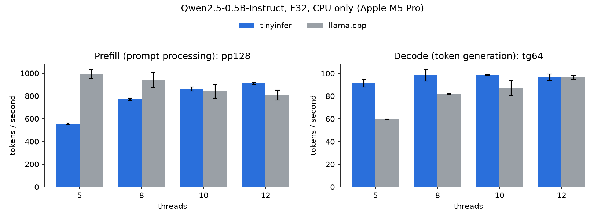

# tinyinfer

A small LLM inference engine I wrote in C++17 to understand what actually happens when a model generates text. It runs GPT-2 and Llama-style models (I test with Qwen2.5-0.5B-Instruct), with a KV cache, sampling, and multithreaded NEON kernels.

No PyTorch, no BLAS, nothing ML-related in the runtime. Python only shows up in `scripts/export.py`, which converts Hugging Face weights into a simple binary format and saves reference outputs so every piece can be checked against Hugging Face.

On my M5 Pro, CPU only, with the same Qwen2.5-0.5B F32 weights, tinyinfer generates tokens at roughly the same speed as llama.cpp (98.6 vs 96.4 tok/s at best, 102–104% over two runs). Prompt processing is slower, 78–95% depending on the run, mostly because llama.cpp hands those matmuls to Apple's Accelerate library. More on that [below](#performance).



## Building it

```bash
python3 -m venv .venv && .venv/bin/pip install -r scripts/requirements.txt
.venv/bin/python scripts/export.py --model gpt2 --out models/gpt2
.venv/bin/python scripts/export.py --model Qwen/Qwen2.5-0.5B-Instruct --out models/qwen2.5-0.5b
cmake -B build && cmake --build build -j
ctest --test-dir build --output-on-failure
```

On macOS you'll want `brew install libomp` for multithreading. Without it everything still builds, just single-threaded.

Then:

```bash
# GPT-2, greedy
./build/tinyinfer -p "In a shocking finding, scientists discovered a herd of unicorns living in" -n 40

# sampling
./build/tinyinfer -p "Once upon a time" -n 40 --temp 0.8 --top-p 0.9 --seed 42

# chat with Qwen
./build/tinyinfer -m models/qwen2.5-0.5b --chat -p "Explain what a KV cache is in one sentence."
```

Other flags: `--top-k`, `--threads`, `--no-cache`, `--ignore-eos`. Run `./build/tinyinfer -h` for the list. If you don't pass `--seed`, the one it used gets printed at the end so you can reproduce a run.

## How it's laid out

```
src/       the runtime
tests/     unit tests and Hugging Face comparison tests (CTest)
scripts/   weight export, benchmark scripts
bench/     benchmarks and saved results
models/    exported weights (gitignored)
```

The interesting files:

- `gpt2.cpp`: GPT-2 forward pass, uncached and cached
- `llama.cpp`: the Llama/Qwen2 decoder (RMSNorm, RoPE, grouped-query attention, SwiGLU)
- `attention.cpp`, `kv_cache.cpp`: causal self-attention, and the cached version used for decode
- `rope.cpp`, `top_p.cpp`: rotary embeddings and nucleus sampling
- `kernels.cpp`: the fast matmul
- `tokenizer.cpp`: byte-level BPE for GPT-2 and Qwen2

## How I built it

I did it in steps, one commit each, and each step had to match Hugging Face before moving on.

1. **Scaffold and export.** CMake, plus a script that dumps GPT-2's weights and the reference outputs: logits, the hidden state after every layer, and greedy continuations.
2. **Tensors, loader, naive matmul.** The weight file is mmapped, so loading is instant and tensors are just pointers into it.
3. **GPT-2 forward pass.** The logits match Hugging Face. Saving every layer's hidden state made it easy to see which block was wrong when something broke.
4. **Tokenizer and greedy generation.** Byte-level BPE written from scratch, including GPT-2's pre-tokenizer regex. Generated tokens match Hugging Face exactly.
5. **Sampling.** Temperature, top-k, top-p, and a seeded RNG of my own so a seed gives the same output on any compiler.
6. **KV cache.** Separate prefill and decode paths.
7. **Llama-style models.** Qwen2.5-0.5B-Instruct, with its own tokenizer rules and special tokens.
8. **Performance.** Threads, SIMD, and benchmarking against llama.cpp.

A CUDA backend is next.

## The KV cache

Without a cache, every new token reruns the whole sequence through the model. Because of the causal mask, earlier tokens never see later ones, so their keys and values never change. The cache stores them once per layer, and each decode step only processes the new token.

GPT-2 small, single thread, still with the naive matmul:

| prompt length | cache | decode tok/s |
|---:|:---:|---:|
| 16 | off | 0.87 |
| 16 | on | 19.6 |
| 128 | off | 0.19 |
| 128 | on | 20.2 |

That's 22x faster with a short prompt and 106x with a longer one. Without the cache it gets slower as the text grows; with it, speed stays flat.

The cache is laid out as `[layer, head, position, head_dim]`, so one head's history sits contiguously in memory and attention reads straight through it.

## Llama-style models

Moving from GPT-2 to Qwen2 mostly meant swapping parts:

- LayerNorm becomes **RMSNorm** (no mean subtraction, no bias).
- Learned position embeddings become **RoPE**, which rotates q and k by an angle that depends on position, inside every layer.
- Every head having its own K/V becomes **grouped-query attention**: 14 query heads share 2 K/V heads, so the cache is 7x smaller.
- The GELU MLP becomes **SwiGLU**: `(silu(x Wg) * x Wu) Wd`.

The tokenizer is the same BPE with a different pre-tokenizer regex (digits get split one at a time, contractions are case-insensitive) and handling for special tokens like `<|im_start|>`.

## Performance

The original version was one naive triple loop, around 5 GFLOP/s. Here's what got it to llama.cpp's decode speed:

- **NEON matmul with register tiling.** It computes a 4x4 block of outputs at once, with 16 accumulators kept in registers. Decode uses a 1x4 version since there's only one input row. Prefill matmuls went from about 5 to about 1000 GFLOP/s.
- **OpenMP with small dynamic chunks.** Apple chips mix fast and slow cores, so a fixed split leaves the fast cores waiting on the slow ones.
- **Keeping threads spinning between matmuls.** This was the biggest surprise. Decode runs about 100 small matmuls per token, and by default libomp puts idle threads to sleep. Waking them took around 60 µs for a matmul that only needed 4 µs. Keeping them spinning took a small projection at 10 threads from 61 µs to 7 µs.
- **Fewer threads for small matmuls,** so a half-megabyte projection doesn't wake up 12 cores.
- **Fusing Q/K/V and gate/up** into single matmuls, so there are fewer synchronization points per layer.

The naive matmul is still in `matmul.cpp`, and the tests compare the fast one against it.

### Against llama.cpp

To keep it fair, both engines ran the same weights (Qwen's official GGUF, expanded to F32 with `llama-quantize`). I ran llama.cpp with `llama-bench -dev none -ngl 0` to keep it on the CPU, and `bench_model` measures the same two things: `pp128` processes a 128-token prompt in one batch, and `tg64` generates 64 tokens one at a time. Two back-to-back runs, 5 repetitions each:

| | tinyinfer | llama.cpp | run 1 | run 2 |
|---|---:|---:|---:|---:|
| generation (tg64) | 98.6 tok/s | 96.4 tok/s | 104% | 102% |
| prompt (pp128) | 911 tok/s | 993 tok/s | 95% | 92% |

llama.cpp's prompt speed moves around a fair bit on this machine. In one solo run it hit 1164 tok/s, which would put tinyinfer at 78%. Generation stayed about even every time. Raw numbers are in `bench/results/`, and `scripts/bench_vs_llamacpp.sh` reruns everything (it needs `brew install llama.cpp`).

For GPT-2 small, generation went from 0.87 tok/s (no cache, naive matmul) to 19.6 with the cache, to 331 after the performance work.

### Why generation is memory-bound

Generating a token multiplies a single vector by every weight matrix in the model. Each weight gets loaded from memory, used for one multiply-add, and that's it.

For Qwen2.5-0.5B in F32, that's about 1.98 GB of weights per token, for roughly 1 GFLOP of math, or half a FLOP per byte loaded. At 98.6 tok/s tinyinfer streams about 195 GB/s, close to the fastest I measured any single matmul streaming on this machine (about 235 GB/s). It's only doing about 97 GFLOP/s of actual arithmetic, around a tenth of what the same kernels manage on prompts. The cores spend most of their time waiting for memory, so any two reasonably written engines end up at about the same speed. That's what the benchmark shows.

Prompt processing is the opposite. With 128 tokens, every weight loaded gets reused 128 times, so the limit is compute, and the quality of the matmul kernel matters. That's where llama.cpp pulls ahead: it uses Apple's matrix hardware through Accelerate, while my kernel only uses the regular NEON units. A packed GEMM kernel would probably close most of that gap.

A few things follow from the memory limit:

- **Smaller weights are faster.** F16 would roughly double generation speed, and 4-bit about 8x. That's why everyone runs quantized models.
- **Adding threads stops helping** once memory is saturated. Generation peaks around 8–10 threads, and 15 is actually slower.
- **Batching helps servers.** Generating for 8 users at once loads each weight once for 8 tokens.

## Weight format

`.tinf` is a deliberately simple container that C++ can read in about 100 lines:

```
"TINF"              magic
version             u32
n_config            u32, then (key_len u32, key, value i64) pairs
n_tensors           u32, then for each:
                      name_len u32, name, dtype u32 (0 = f32, 1 = i32), ndim u32,
                      dims i64[ndim], offset u64, nbytes u64
tensor data         each tensor 64-byte aligned
```

All linear weights are stored `[out, in]`, so every layer is `y = x @ Wᵀ + b`. GPT-2's weights come the other way around, so the export transposes them. With that layout, each output is a dot product of two contiguous rows, which is the cache-friendly direction.

`reference.tinf` uses the same format and holds each test prompt's text, token ids, logits, per-layer hidden states and 32 greedy tokens, plus some extra tokenizer cases (contractions, whitespace runs, Unicode, emoji).
